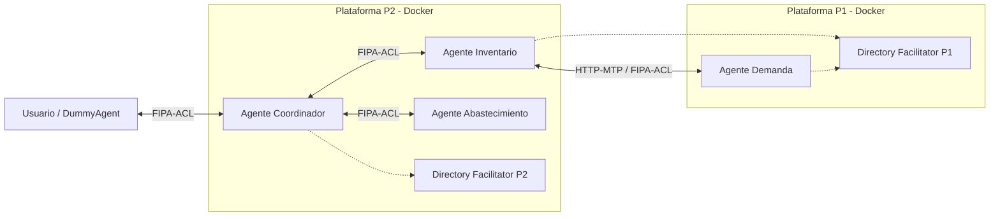
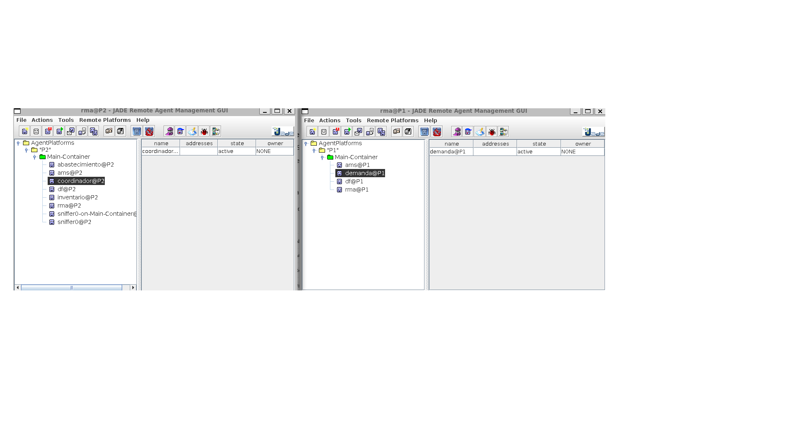
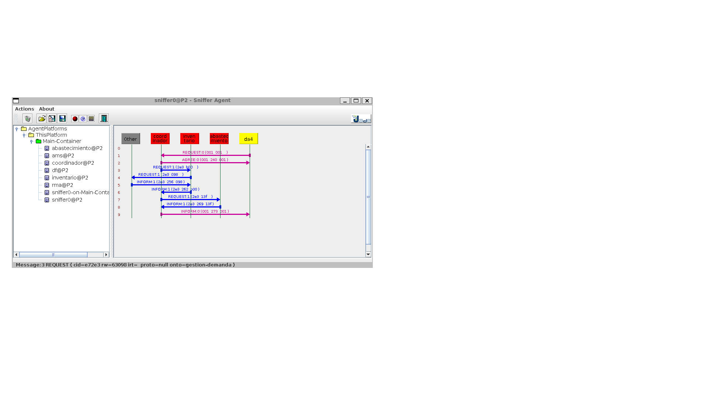
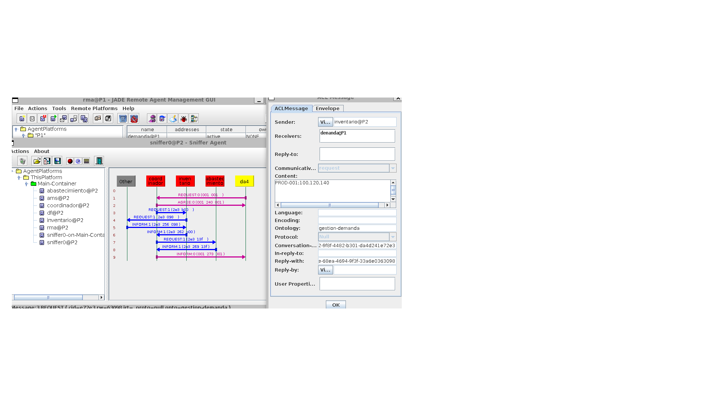

# Sistema Multiagente Distribuido con JADE y Docker

## 1. Descripción del proyecto

Sistema multiagente distribuido para la gestión de demanda,
inventarios y abastecimiento, desarrollado mediante Java,
JADE, Maven y Docker.

El sistema integra agentes especializados que cooperan
mediante mensajes FIPA-ACL para generar recomendaciones
de abastecimiento a partir de las ventas históricas,
el inventario disponible y el stock de seguridad.

Versión funcional: 1.4.

## 2. Objetivo

Implementar un sistema multiagente distribuido que permita
coordinar el pronóstico de demanda, determinar necesidades
de reposición de inventario y seleccionar proveedores
mediante la interacción de agentes especializados.

## 3. Tecnologías utilizadas

- Java 11 (versión objetivo de compilación).
- JADE 4.3 (dependencia Maven).
- Apache Maven.
- JUnit 5.9.2.
- Docker Desktop.
- Docker Compose.
- WSL 2 y Ubuntu.
- WSLg para las interfaces gráficas.
- FIPA-ACL.
- HTTP-MTP.

## 4. Arquitectura distribuida

El sistema está organizado en dos plataformas JADE
independientes, desplegadas mediante contenedores Docker
conectados a una red común.

| Plataforma | Contenedor | Agentes |
|---|---|---|
| P1 | jade-p1 | Demanda |
| P2 | jade-p2 | Coordinador, Inventario y Abastecimiento |

### Arquitectura lógica



## 5. Agentes inteligentes

| Agente | Responsabilidad |
|---|---|
| AgenteCoordinador | Gestiona los escenarios y consolida los resultados. |
| AgenteDemanda | Calcula el pronóstico mediante las ventas históricas. |
| AgenteInventario | Determina las necesidades de reposición. |
| AgenteAbastecimiento | Evalúa proveedores y recomienda una alternativa de abastecimiento. |

## 6. Comunicación entre agentes

Los agentes intercambian mensajes FIPA-ACL.

Las principales performativas utilizadas son:

- REQUEST: solicitud de procesamiento.
- AGREE: aceptación de la solicitud.
- INFORM: comunicación de resultados.
- REFUSE: rechazo de solicitudes inválidas.
- FAILURE: comunicación de fallos de procesamiento.

La comunicación entre plataformas se realiza mediante
HTTP-MTP, utilizando la red interna de Docker.

Los identificadores de conversación permiten correlacionar
los mensajes correspondientes a cada escenario.

## 7. Flujo de procesamiento

1. El usuario envía una solicitud al agente coordinador.
2. El coordinador valida los datos recibidos.
3. El coordinador solicita la evaluación de inventario.
4. El agente inventario consulta al agente demanda.
5. El agente demanda calcula y devuelve el pronóstico.
6. El agente inventario determina la reposición necesaria.
7. Si se requiere reposición, el coordinador solicita
   una recomendación al agente abastecimiento.
8. El coordinador consolida y devuelve el resultado.

## 8. Estructura del proyecto

```text
SMA-JADE-Docker/
├── src/
│   ├── main/java/
│   │   ├── agentes/
│   │   ├── modelos/
│   │   └── servicios/
│   └── test/java/
│       └── servicios/
├── docs/
│   └── evidencias/
│       └── v1.4/
├── Dockerfile
├── docker-compose.yml
├── pom.xml
├── .dockerignore
├── .gitignore
└── README.md
```

## 9. Requisitos de ejecución

- Docker Desktop en funcionamiento.
- Docker Compose.
- WSL 2 con una distribución Ubuntu.
- Integración de Docker Desktop con Ubuntu.
- WSLg habilitado para visualizar las interfaces JADE.
- Conexión a Internet para descargar las dependencias
  durante la construcción inicial.

Para ejecutar Maven directamente se requiere además
Java y Apache Maven.

## 10. Construcción y despliegue

Desde la terminal Ubuntu, acceder a la carpeta del proyecto.

Construir las imágenes:

```bash
docker compose build
```

Iniciar las plataformas:

```bash
docker compose up -d
```

Verificar los contenedores:

```bash
docker compose ps
```

Visualizar los registros:

```bash
docker compose logs -f jade-p1 jade-p2
```

Detener el sistema:

```bash
docker compose down
```

## 11. Ejecución de escenarios

Desde la interfaz gráfica JADE de la plataforma P2,
iniciar un DummyAgent y configurar un mensaje ACL.

| Campo | Valor |
|---|---|
| Receiver | coordinador@P2 |
| Performative | REQUEST |
| Ontology | coordinacion-escenarios |
| Conversation-id | demo-001 |
| Reply-with | solicitud-demo-001 |
| Content | PROD-001;100,120,140;70;20 |

Formato del contenido:

```text
producto;ventas_historicas;stock_actual;stock_seguridad
```

Resultado esperado:

- Pronóstico: 120 unidades.
- Stock actual: 70 unidades.
- Stock de seguridad: 20 unidades.
- Reposición necesaria: 70 unidades.
- Proveedor seleccionado: Proveedor C.
- Precio unitario: S/ 16.00.
- Costo total: S/ 1120.00.
- Plazo de entrega: 1 día.
- Puntaje: 0.9375.

## 12. Validación funcional

| Escenario | Resultado observado |
|---|---|
| Inventario insuficiente | PROVEEDOR_SELECCIONADO |
| Inventario suficiente | NO_REQUIERE_COMPRA |
| Disponibilidad insuficiente de proveedores | SIN_PROVEEDOR_ELEGIBLE |
| Stock negativo | REFUSE |
| Formato de entrada incorrecto | REFUSE |
| Solicitudes sucesivas | Procesamiento de escenarios independientes |
| Plataforma remota no disponible | FAILURE |
| Restablecimiento de plataforma remota | Procesamiento satisfactorio de una nueva solicitud |

## 13. Pruebas unitarias

Ejecutar:

```bash
mvn clean test
```

Las pruebas unitarias comprenden los servicios de:

- Pronóstico de demanda.
- Gestión de inventarios.
- Evaluación de abastecimiento.

## 14. Evidencias de funcionamiento

### Plataformas JADE distribuidas



### Interacción de agentes mediante FIPA-ACL



### Comunicación entre plataformas



Las evidencias complementarias de configuración,
despliegue y ejecución se encuentran en:

docs/evidencias/v1.4/

## 15. Alcance y limitaciones

El sistema constituye un prototipo académico funcional.

El pronóstico utiliza un promedio de ventas históricas.
La selección de proveedores se realiza mediante los
criterios implementados en el servicio de abastecimiento.

El sistema genera recomendaciones y no ejecuta órdenes
de compra reales.

El despliegue distribuido se realiza mediante dos
contenedores independientes en un mismo equipo físico.

## 16. Contexto académico

Universidad Nacional Mayor de San Marcos.

Facultad de Ingeniería de Sistemas e Informática.

Proyecto académico de sistemas multiagente.
